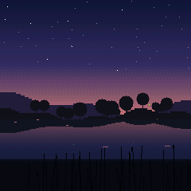
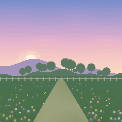
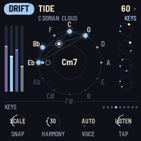
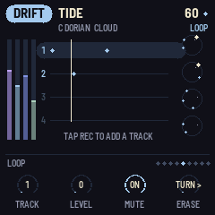
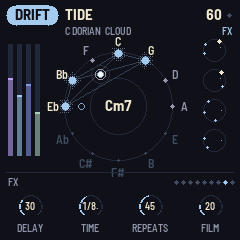
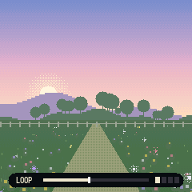
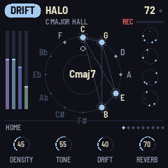

# MOSS-1 manual

MOSS-1 is ambient firmware for the M-VAVE FM-1. Turn it on and it starts playing. Play the keys and the music
picks up what you play.

## The short version

- **PRESETS** picks the scene. There are 16, across three modes.
- **ALGORITHM** picks the space: the character of the reverb and delay.
- **SELECT** steps through the pages. **K1 to K4** change the page you are on.
- **The keys** play along, in key.
- **REC** is the looper. **ARP** freezes the sound.
- **SEQ** switches the screen between the picture and the studio view.
- **SAVE** saves your settings.

## The panel

| Control | What it does |
| --- | --- |
| PRESETS | Next or previous scene |
| ALGORITHM | Next or previous space |
| SELECT | Next or previous page |
| HOME | The HOME page |
| SEL | The MIX page. Press again for BEAT |
| ENV | The KEYS page. Press again to change how the keys play (PLAY, LISTEN or HOLD) |
| LFO | The LOOP page. Press again for SHAPE, and again for SLOTS |
| FX | The FX page |
| GLO | The SETUP page |
| K1 to K4 | The four knobs of the page you are on |
| REC | The looper: tap to record, tap to loop, tap to add a track. Hold for a second to clear. See [Looping](#looping) |
| ARP | Freeze: the reverb holds what it has and new sound plays dry over it. In SCAPES and DRIFT the chord also stops changing. Press again to let go |
| PLAY | Start or stop the music. The screen says RESTING while it is stopped. Your loop keeps going |
| EDIT | A new variation: new chords, new bell patterns in DRIFT, new weather in SCAPES. Your loop is not touched |
| SEQ | Picture or studio view |
| SAVE | Save your settings. Hold for two seconds and let go to reset the scene |
| OCT- and OCT+ | Move the keys down or up an octave, from -2 to +2 |
| MASTER | Volume |

The lit page button shows which page you are on. SAVE stays lit while there are changes you have not saved. Lit
keys show the notes of the chord that is playing.

## Modes and scenes

**LOFI**: electric piano chords on a slow, swung beat with a soft bass. Study, Rainy, Night, Tape.

**SCAPES**: nature with a quiet pad and a few notes. Forest, Rain, Shore, Night, Storm, Hearth, Creek.

**DRIFT**: slow pads and bells on loops of different lengths, so it never quite repeats. Halo, Tide, Glass, Dusk,
Garden. Garden is the bright one: quicker kalimba loops, birdsong and a soft beat.

PRESETS goes through them all in one list: LOFI, then SCAPES, then DRIFT, then back to the start. MOSS-1 starts
on DRIFT Garden.

Each scene sets its own HOME and MIX knobs, tempo, mood and beat. Changing scene loads them. The KEY, the space
and the KEYS, LOOP, SHAPE and FX pages stay as you set them, whatever the scene.

To get a scene back to how it started, hold SAVE until the screen says LET GO TO RESET SCENE, then let go. That
resets its HOME and MIX knobs, tempo, mood and beat.

## The pages

Turn SELECT, or press a page button. In the studio view the page name is at the bottom left. In the picture view,
turning a knob shows its name and value for a moment.

### HOME

The main knobs. They change with the mode.

| | K1 | K2 | K3 | K4 |
| --- | --- | --- | --- | --- |
| LOFI | TONE: dark to bright | DUST: crackle, then fewer bits | WOBBLE: tape wow | REVERB: size and length |
| SCAPES | WEATHER: calm to wild | LIFE: how many birds and crickets | TONE | REVERB |
| DRIFT | DENSITY: how many bell notes | TONE | DRIFT: how fast things change | REVERB |

### MIX (SEL)

The level of each part.

| | K1 | K2 | K3 | K4 |
| --- | --- | --- | --- | --- |
| LOFI | KEYS: the piano | BEAT | BASS | RAIN |
| SCAPES | NATURE: wind, rain, water, fire | LIFE: birds and crickets | PAD | NOTES |
| DRIFT | PAD | BELLS | BASS | AIR |

### BEAT (SEL twice)

Drums and a backing bass, in any mode. The LOFI scenes and DRIFT's Garden start with a kit. The others start
with none.

| Knob | What it does |
| --- | --- |
| KIT | OFF, SOFT, LOFI, BRUSH, PULSE, TICK, WOOD |
| PATTERN | AUTO, BOOMBAP, HALF, FOUR, BOSSA, HEART, SHUFFLE, BROKEN, WALTZ, SPARSE. AUTO is the scene's own groove in LOFI and SPARSE elsewhere |
| LEVEL | How loud the drums are, and the ROOT or WALK bass |
| BASS | AUTO (the mode's own), OFF, ROOT (on the chord root, with the kick), WALK (moves through the chord) |

### KEYS (ENV)

| Knob | What it does |
| --- | --- |
| SNAP | FREE plays the note you press. SCALE moves it to the nearest note in the key. CHORD moves it to the nearest note of the chord playing now |
| HARMONY | Adds softer chord notes under each note you play |
| VOICE | The sound of the keys. AUTO uses the mode's own sound |
| TAP | How the keys play: PLAY, LISTEN or HOLD. Pressing ENV again on this page does the same |

**PLAY**: the keys just play.

**LISTEN** (where it starts): the music listens to you.

- What you play starts a loop by itself. Stop for two seconds and it closes and repeats, fading and changing a
  little each time.
- Notes you play over a running loop are added to it. Each phrase after a pause goes on its own track.
- In SCAPES and DRIFT, a note outside the chord moves the music to a chord that has it.
- DRIFT puts your note into one of its bell loops. LOFI's melody plays your notes back. In SCAPES a bird answers.
- The more you play, the busier the music gets for a while: more bells, more birds, more ghost notes and fills.

To play over a loop without adding to it, switch TAP to PLAY.

**HOLD**: build the music by adding and taking away notes. The lit keys are the notes the music plays from, which
starts as the key's scale.

- Tap a lit key to take that note away. The pads, bells, chords, melody, bass and your loop stop using it and play
  the nearest note they still have. Take enough away and the music thins to a few notes, or to one drone.
- Tap a dark key to add that note, even one outside the key. It swells in once, low and soft, so you hear it
  arrive, and then the music uses it.
- The last note always stays.
- Changing KEY or MOOD starts again from that scale.

In HOLD the keys don't play notes themselves, so there is nothing for REC to loop.

### LOOP (LFO)

The loop's tracks, shown as lanes of dots in the studio view. The screen switches to the studio view on this page.

| Knob | What it does |
| --- | --- |
| TRACK | Pick a track, 1 to 4. Its lane is highlighted |
| LEVEL | How loud that track is. At 0 it is silent, and so is anything recorded on it next |
| MUTE | Turn right: on. Turn left: muted |
| ERASE | Keep turning right until the gauge fills: the track is erased. Stop for a moment and the gauge empties again |

### SHAPE (LFO again)

| Knob | What it does |
| --- | --- |
| FADE | How fast the loop dies away. 0 keeps it forever. When every note has faded, the loop is gone |
| MUTATE | How often notes move to a nearby note, jump an octave or move in time |
| SMEAR | Backwards swells under your notes, and softer, slower repeats |
| SPEED | 1/2, 1x, 2x, REV, REV 1/2 |

### SLOTS (LFO a third time)

Eight places to keep loops. They stay after you turn the FM-1 off. The screen switches to the studio view on this
page and lists what each slot holds.

| Knob | What it does |
| --- | --- |
| SLOT | Pick a slot, 1 to 8 |
| SAVE | Turn right: the loop playing now goes into the slot, replacing what was there |
| LOAD | Turn right: the slot's loop starts playing, replacing the loop you have |
| DELETE | Keep turning right until the gauge fills: the slot is emptied |

Shortcut: the first eight white keys are the eight slots. Hold SAVE and tap one to save there. Hold SEQ and tap
one to load it. While SAVE or SEQ is held, the keys holding a loop light up.

### FX

| Knob | What it does |
| --- | --- |
| DELAY | How much goes into the delay |
| TIME | 1/16 to 1/2, in time with the tempo |
| REPEATS | How long the echoes last |
| FILM | Old tape: wobble, hiss, crackle, saturation, a duller top and the odd dropout |

### SETUP (GLO)

| Knob | What it does |
| --- | --- |
| TEMPO | Beats per minute |
| KEY | The key everything plays in |
| MOOD | MAJOR, MINOR, DORIAN, LYDIAN or MIXOLYD (Mixolydian) |
| SLEEP | Fades out and stops after 10 to 90 minutes |

SLEEP fades the sound over the last third of the time, five minutes at most. At the end the screen says
GOODNIGHT, everything goes quiet (the keys too) and SLEEP turns itself off. Press PLAY to start again. Changing
SLEEP starts the timer again. The studio view shows the minutes left.

The CPU number on this page shows how hard the FM-1 is working.

## Spaces

Turn ALGORITHM.

| Space | Sound |
| --- | --- |
| HALL | A big, soft room |
| PLATE | Shorter and brighter |
| CLOUD | Huge, slow and blurred |
| SHIMMER | Adds an octave above the reverb |
| TAPE | Wobbly echoes that run into the reverb |
| REVERSE | Everything swells in backwards |

## Looping

REC is the looper. The screen always says what the next tap does.

1. Tap REC: recording. Play.
2. Tap REC: the loop plays.
3. Tap REC: add a track on top. Play.
4. Tap REC: done adding. Repeat 3 and 4 for up to four tracks.
5. Hold REC for a second: the loop is cleared.

With TAP on LISTEN you don't need REC: just play, and stop for two seconds.

The bar at the bottom of the picture shows the loop. It is red while recording and cream while playing. The four
squares next to it are the tracks: bright when on, grey when muted, dark when empty.

A recording stops by itself after 60 seconds. A loop holds 96 notes; past that, new notes replace the quietest.
The loop keeps playing when you press PLAY to stop the music, so you can play over silence. HOLD's notes are not
looped.

The LOOP page sets each track's level, mutes it or erases it. The SHAPE page sets how the loop fades and changes.
The SLOTS page saves and loads loops.

## The two views

Press SEQ.

**Picture**: a pixel landscape for the scene. Notes light up fireflies, windows or flowers. Rain, wind, birds and
lightning follow the sound. FROZEN at the top means ARP's freeze is on.

**Studio**: the notes. The wheel has all twelve notes in fifths. The chord is lit and joined by lines, and each note
you hear blooms where it falls. The bars on the left are the part levels. The column on the right shows DRIFT's
loops, the beat when a kit is on, or SCAPES's weather. The knobs are at the bottom.

## MIDI

Over USB, the keys send notes on channel 1, and notes from the computer play like the keys.

## Recipes

**Falling asleep**: SCAPES Rain or Night. SETUP, SLEEP to 30m. Turn MASTER down.

**Study**: LOFI Study. FX, FILM to 40. MIX, BEAT lower if it distracts.

**Play a little, listen a lot**: DRIFT Dusk, space CLOUD. Play three or four notes and stop. SHAPE, FADE low and
MUTATE high.

**Backwards garden**: DRIFT Halo, space REVERSE. SHAPE, SMEAR to 70. Play slowly.

**A drone you build**: any scene, TAP on HOLD (press ENV twice). Take notes away until only two or three are lit,
then add one outside note and listen to the music bend around it.

## Recording

The FM-1 shows up on your computer as an audio input over USB. Record it in any audio app, or use the MOSS-1 tape
deck page in Chrome: press Connect, then the big button or space to record. Takes can be named, played, downloaded
as WAV and deleted. The same page reads your saved loops and downloads each one as a MIDI file, one MIDI track per
loop track.

## Going back to stock firmware

Open <https://thefirmwarehub.com> in Chrome or Edge with the FM-1 plugged in and install the M-VAVE firmware.

If the FM-1 ever stops starting, hold OCT- while you turn it on. It comes up in the chip's own update mode, and
<https://thefirmwarehub.com/tools/rescue/> puts the stock firmware back.
